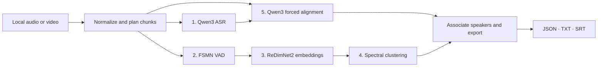

# ZiYor-ASR-5c · Meeting ASR Basic5

**Turn a local meeting recording into a transcript with speaker labels, timestamps, and subtitles.**

[](pyproject.toml)
[](LICENSE)

Basic5 is a five-component transcription baseline for Chinese meetings. The configuration also accepts English. Once the models are downloaded, inference runs locally. Speaker labels such as `S01` group turns within one recording.

## 🚀 Quick start

For the inference setup, use **Linux x86-64, Python 3.12 with venv support, FFmpeg, and an NVIDIA driver compatible with CUDA 12.8**. The setup script defaults to PyTorch 2.10 CUDA 12.8 wheels. Allow disk space for the separate runtimes, model weights, and intermediate audio.

```bash
git clone https://github.com/ziyor-ai/ZiYor-ASR-5c.git
cd ZiYor-ASR-5c
bash scripts/setup.sh
.venvs/core/bin/python scripts/download_models.py --config config.json
.venvs/core/bin/python -m basic5 doctor --config config.json
```

`doctor` checks worker imports and the configured device without running inference. Then transcribe a recording:

```bash
.venvs/core/bin/python -m basic5 transcribe /path/to/meeting.wav \
  --config config.json --output outputs/meeting-001
```

FFmpeg can also read formats such as MP3 and MP4. Basic5 uses the first audio stream and its first channel. Each run requires a new output directory and refuses to overwrite an existing one.

If you already have the models, skip the download and set the four model paths in `config.json`. If you manage the worker environments yourself, set the two interpreter paths as well. Relative paths are resolved from the config file. The ReDimNet checkpoint must match the SHA-256 of the official `b0-vox2-lm.pt` file.

To inspect the CLI without installing the model runtimes or downloading weights:

```bash
python3.12 -m venv .venvs/core
.venvs/core/bin/python -m pip install -e .
.venvs/core/bin/python -m basic5 components
```

## 🧩 How it works



Qwen3-ASR-1.7B recognizes speech, FSMN-VAD finds speech intervals, and ReDimNet2-B0 embeds short voice windows. Spectral clustering groups those windows by speaker, and Qwen3-ForcedAligner-0.6B supplies timestamps for the recognized text. The three inference stages run in order in separate processes, using isolated Qwen and speaker environments. See [architecture](docs/architecture.md) for the alignment and speaker assignment rules.

## 📄 Outputs

| Path | Contents |
| --- | --- |
| `transcript.json` | Structured transcript, word times, speaker turns, and quality flags |
| `transcript.txt` | Readable transcript with speaker labels and times |
| `transcript.srt` | Subtitles; entries without a representable duration are omitted |
| `run.json` | Run status, configuration, stage durations, and file hashes |
| `logs/`, `work/` | Process logs, normalized audio, and intermediate results |

Keep the run directory private if the source recording is private. A failed stage produces a nonzero exit code and records failure in `run.json`. Press Ctrl-C to stop a run and clean up its worker processes.

## ⚙️ Configuration

| Setting | Default and use |
| --- | --- |
| `language` | `Chinese`; set to `English` for English audio |
| `num_speakers`, `max_speakers` | Estimate the count by default (`null`) with a limit of 8; set `num_speakers` when the count is known |
| `chunk_seconds`, `cut_search_seconds` | 28-second target; search the final 6 seconds for a quieter cut |
| `max_audio_seconds`, `stage_timeout_seconds` | Four hours each; limits apply to input length and to each worker stage, respectively |
| `device`, `dtype` | `cuda:0` and `bfloat16`; `cpu` with `float32` is an experimental fallback |

## 🔍 Scope and validation

Basic5 estimates speaker turns on one main speaker track. Overlapping speech, brief interjections, and distant microphones can reduce transcription or speaker attribution quality. When alignment fails, the full recognized text is preserved with chunk bounds and marked `unaligned_text_preserved`. Ambiguous speaker assignments appear as `unknown`.

Source and CPU behavior tests are documented in [validation](docs/validation.md). Full model inference, GPU resource use, and AliMeeting accuracy have yet to be measured for Basic5. Apple MPS is unsupported.

See [Vision](VISION.md) for the roadmap and [Contributing](CONTRIBUTING.md) for the test and packaging workflow. Project code is [Apache-2.0](LICENSE), and the vendored ReDimNet2 implementation is [MIT](vendor/ReDimNet2-LICENSE). See [third-party notices](THIRD_PARTY.md) for the model sources and licenses. The source archive excludes model weights and recordings.
