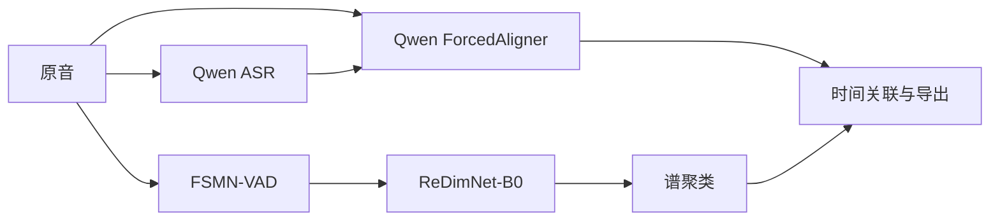

# 五项核心技术与边界

“五项”固定指下表的模型／核心算法，不把 FFmpeg、文件校验、切块、导出和基础时间关联另算成模型。该定义保持透明，避免把胶水代码拆成更多“优化方法”。

| 编号 | 核心组件 | 输入 → 输出 |
|---|---|---|
| 1 | Qwen3-ASR-1.7B | 原音连续覆盖的短块 → 原始转写文字 |
| 2 | FSMN-VAD | 原音 → 语音区间 |
| 3 | ReDimNet2-B0 | 语音短窗 → 声纹向量 |
| 4 | 谱聚类 | 声纹向量 → 录音内部 S01、S02…及分人区间 |
| 5 | Qwen3-ForcedAligner-0.6B | 原音＋已有文字 → SDK 后处理的词时间 |

Qwen 与说话人模型使用独立依赖环境，三个实际模型阶段由独立子进程顺序运行：ASR → VAD/声纹/聚类 → 对齐。阶段结束释放其模型。推理仅读取本地模型目录，不调用云转写服务。

ASR 采用原项目的非重叠、低能量切点思想，默认在 22–28 秒找切点，所有样本覆盖一次。这是便于基础版复现的工程取舍；不是原 U08 的流式识别，也不是已经通过 Eval8 验证的 E002。切点附近仍可能有识别损失。

谱聚类自动人数采用启发式；可以通过 `num_speakers` 显式给定已知人数。仅有 1 个有效窗口时返回 1 人；没有可用声纹窗口时保留文字、说话人未知。过短语音不会强行套用邻人的身份。默认最多 2000 个均匀选取的声纹窗口参与谱分解，其余按聚类中心分配；该规则限制矩阵规模，不是准确率保证。

此方案产生单一主说话人活动轨，不分离重叠语音，不能完整表达两人同时发言。跨段编号只在本录音内有效。声纹来自 VoxCeleb2，中文远场多人会议存在域差异。

完全断开的声纹图加入极小连接，避免孤立窗口导致谱向量归一化报错；此时人数估计参考连通分量数，仍受最大人数限制。强制低人数导致中心向量相互抵消时，用该簇首个有效向量代表，并在结果记录 `cancelled_centers`。这些是聚类边界处理，不是额外优化模型。

对齐失败时完整保留该块文字，以块边界标记，并将说话人置为 unknown。零时长词在 JSON/TXT 保留，不伪造正时长；纯零时长字幕无法有效表示于 SRT，SRT 会省略该条，完整文本以 JSON/TXT 为准。词时间准确性需要人工边界评测，不能用文本保留检查代替。

高级研究模块没有加入：MOSS、Fun-ASR 多路候选、CTC 校验、BM25 热词、多个声纹投票、Community-1、帧级重分段、句尾 LLM、SepFormer 等。没有故意损坏基础功能，也没有隐藏的高级开关。
